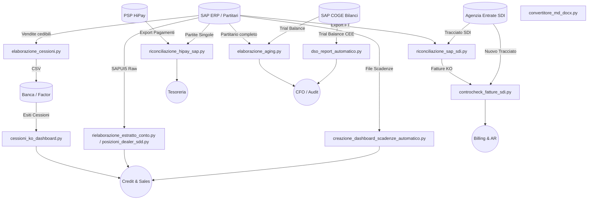

# 📊 Kolme Finance Automation Platform

Benvenuto nella **Kolme Finance Automation Platform**. Questo repository è una suite integrata di automazione finanziaria (micro-script Python) progettata per fungere da ponte intelligente tra l'ERP aziendale (SAP), i provider esterni (HiPay, SDI, Istituti Bancari per Cessioni/SDD) e i report manageriali per il Credit Management, Sales e Controllo di Gestione.

Il progetto include sia una comoda **Dashboard Web locale** per il caricamento ed esecuzione degli script senza competenze tecniche, sia la possibilità di esecuzione diretta via riga di comando (CLI).

---

## 🛠️ Architettura e Flusso dei Processi

La piattaforma gestisce i flussi finanziari aziendali suddividendoli in quattro aree principali:
1. **Fatturazione & Compliance (SDI/Agenzia delle Entrate)**
2. **Incassi e Tesoreria (HiPay, Cessioni Factor)**
3. **Operations & Estratti Conto (SDD, Customer Care)**
4. **Month-End Accounting & Controllo Crediti (Aging, DSO)**

### Schema delle Interazioni (Data Flow)



---

## 📂 Catalogo degli Script (`scripts/`)

Tutti gli script sono stati standardizzati in minuscolo con separatori `_` per una gestione contabile ottimale:

| Script | Area | Descrizione |
| :--- | :--- | :--- |
| **`cessioni_ko_dashboard.py`** | Tesoreria | Raggruppa i KO delle cessioni credito e genera un Excel con grafici per dealer/causale. |
| **`controcheck_fatture_sdi.py`** | Compliance | Verifica a posteriori se le fatture precedentemente scartate da SDI sono state registrate nel nuovo export. |
| **`creazione_dashboard_scadenze_automatico.py`** | Credit | Genera un cruscotto HTML interattivo sul Collection Rate, insoluti ed esposizione fido. |
| **`dso_report_automatico.py`** | Working Capital | Calcola DSO e DPO su 3 livelli (Global, Interno, Specifico) a partire dal bilancio SAP. |
| **`elaborazione_cessioni.py`** | Tesoreria | Normalizza il tracciato cessioni giornaliero generando il CSV per la banca/factor. |
| **`posizioni_dealer_sdd.py`** | SDD / AR | Pulisce pareggi tecnici ed elimina storni contabili per la pianificazione degli SDD. |
| **`rielaborazione_estratto_conto.py`** | Customer Care | Crea estratti conto interattivi per i dealer con hyperlink per le partite "SU". |
| **`riconciliazione_hipay_sap.py`** | Riconciliazione | Effettua la riconciliazione automatica bidirezionale tra transazioni HiPay e partite contabili SAP. |
| **`riconciliazione_sap_sdi.py`** | Compliance | Identifica le fatture emesse su SAP che non risultano ancora trasmesse a SDI. |
| **`elaborazione_aging.py`** | Month-End | Calcola l'invecchiamento dei crediti e riconcilia il partitario con il bilancio di verifica. |
| **`convertitore_md_docx.py`** | Utility | Converte file Markdown (`.md`) in documenti Word (`.docx`) rifiniti (usato anche per esportare l'analisi). |

---

## 🚀 Installazione e Avvio Rapido

### 1. Requisiti di sistema
Assicurati di aver installato Python 3 e di trovarti nella cartella principale del progetto nel terminale.

### 2. Installazione delle dipendenze
Installa tutti i moduli richiesti lanciando:
```bash
pip install -r requirements.txt
```

### 3. Avvio della Dashboard Web
Per avviare la comoda interfaccia grafica web locale ed eseguire gli script via browser:
```bash
python app.py
```
Apri il browser ed accedi a: **[http://127.0.0.1:5001](http://127.0.0.1:5001)**

### 4. Utilizzo della Dashboard Web
1. Trascina i tuoi file Excel o CSV contabili nel box di sinistra (**Area File di Lavoro**).
2. Seleziona lo script che vuoi eseguire nella griglia centrale.
3. Compila gli input richiesti (la dashboard ti mostrerà comodi menu a tendina filtrati per estensione).
4. Premi **Esegui**: l'output verrà mostrato in tempo reale nel terminale in basso e, al termine, il file generato verrà **scaricato automaticamente** sul tuo computer e salvato in `uploads/`.

---

## 🛠️ Esecuzione da Terminale (CLI)

Gli script possono essere lanciati anche direttamente da terminale senza interfaccia grafica.

### Esempio: Convertitore MD -> DOCX
```bash
python scripts/convertitore_md_docx.py -i "percorso/file.md"
```
*(Se eseguito senza argomenti, lo script avvierà una finestra grafica del Finder per la selezione interattiva del file)*

### Esempio: DSO Report
```bash
python scripts/dso_report_automatico.py --bilancio "uploads/Bilancio.xlsx" --periodo "Maggio 2026" --data-fine "2026-05-31" --saldo-clienti "6000000"
```

---

## ⚙️ Sotto il Cofano: Mock `google.colab`
Alcuni degli script originali scritti per Google Colab utilizzano la libreria `google.colab.files`. Per permetterne l'esecuzione locale senza dover riscrivere le logiche contabili interne, la piattaforma include un modulo **`google.colab` mock** locale (nella cartella `google/`).

Questo mock:
- Intercetta le chiamate `files.upload()` e le simula leggendo i file caricati nella cartella `uploads/` (o passati come variabili d'ambiente `INPUT_FILES` dalla dashboard).
- Intercetta `files.download()` e copia automaticamente il file di output nella cartella `uploads/`, rendendolo subito scaricabile dalla Dashboard.
