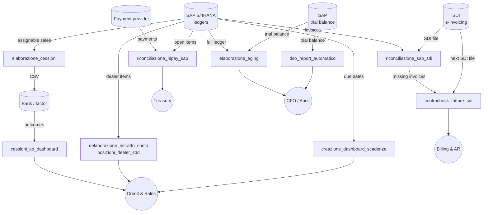

# Kolme Finance Automation Platform

The suite I built during my internship in Finance & Treasury Operations at [Kolme](https://www.kolme.it), a telecom
master dealer that serves a network of retail dealers across Italy. Much of Finance ran on manual exports out of SAP.
I turned the recurring ones into Python scripts that colleagues run from a local web dashboard, without writing code.

Published with Kolme's permission. The repository holds code only: no ledgers, no exports, no customer data.

**Impact, as estimated process by process in the handover deck:** about 65 hours of manual work removed a month,
380 to 780 hours a year depending on volume.

*Documentazione originale in italiano: [README.it.md](README.it.md). The dashboard and the scripts' messages are in
Italian, the language of the team that uses them.*

## How it works

```
Excel / CSV exports  ──►  local dashboard (Flask)  ──►  one script per process  ──►  Excel, CSV or HTML report
(SAP, SDI, bank, PSP)      drag files in, pick a script,      pandas, openpyxl,           downloaded automatically
                           fill the inputs, press Run         xlsxwriter
```

1. Drop the accounting exports into the file area.
2. Pick a script. The dashboard reads each script's docstring to show its name, category, description and instructions.
3. Fill in the inputs and run it. The output streams live to the page, and the generated file downloads when it ends.

Nothing leaves the PC: the dashboard listens on `127.0.0.1` only and the files stay in `uploads/`.

## The processes



| Area | Script | What it does |
|---|---|---|
| Invoicing & compliance | `riconciliazione_sap_sdi.py` | Finds invoices issued in SAP that have not reached the national e-invoicing system (SDI) |
| | `controcheck_fatture_sdi.py` | Checks whether invoices flagged as missing show up in the next SDI file |
| Collections & treasury | `riconciliazione_hipay_sap.py` | Two-way reconciliation between payment-provider transactions and SAP open items |
| | `elaborazione_cessioni.py` | Normalises the daily receivables-assignment file into the CSV the bank or factor expects |
| | `cessioni_ko_dashboard.py` | Groups failed assignments by dealer and reason into an Excel workbook with native charts |
| Dealer operations | `posizioni_dealer_sdd.py` | Cleans technical clearings and reversals to plan direct debits (SDD) per dealer |
| | `rielaborazione_estratto_conto.py` | Builds dealer statements ordered by month, with the balance reconciled and paired items linked |
| | `creazione_dashboard_scadenze_automatico.py` | Generates an interactive HTML dashboard on collection rate, overdue items and credit-line exposure |
| Month-end & credit control | `elaborazione_aging.py` | Ages receivables and reconciles the ledger to the trial balance |
| | `dso_report_automatico.py` | Computes DSO and DPO at three scopes from the SAP trial balance |
| Utility | `convertitore_md_docx.py` | Converts Markdown to a finished Word document (also used to export the written analysis) |

`esempio_lungo.py` is a dummy long-running script, used to test the live output stream.

## Run it

```bash
pip install -r requirements.txt
```

```bash
python app.py
```

Then open http://127.0.0.1:5001. The scripts also run from the command line:

```bash
python scripts/dso_report_automatico.py --bilancio "uploads/Bilancio.xlsx" --periodo "Maggio 2026" --data-fine "2026-05-31" --saldo-clienti "1000000"
```

## Under the hood

| Path | What it is |
|---|---|
| `app.py` | Flask backend: lists the scripts and their metadata, handles uploads, runs a script as a subprocess and streams its output to the page (server-sent events) |
| `templates/index.html` | The dashboard: one page, no build step |
| `scripts/` | One file per process. Drop a new script in and it appears in the dashboard |
| `google/colab/` | A local stand-in for `google.colab.files`. The first scripts were written in Google Colab; this lets them run unchanged, reading from `uploads/` and writing downloads back to it |
| `uploads/` | Working files. Never in git |

## Adding a script

Put a `.py` file in `scripts/` with a docstring that starts like this, and the dashboard picks it up:

```python
"""
Nome: Riconciliazione X vs Y
Descrizione: What it does, in one sentence.
Categoria: Riconciliazione
Istruzioni: Which files to upload and which inputs to fill.
"""
```
